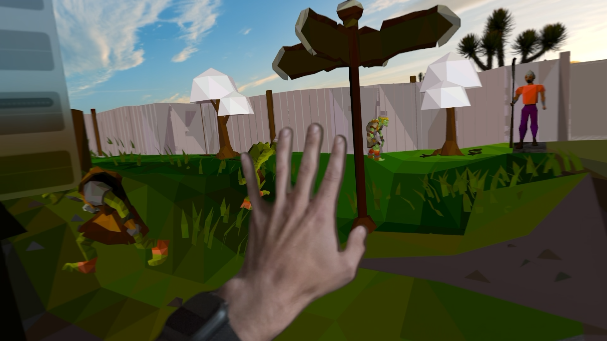
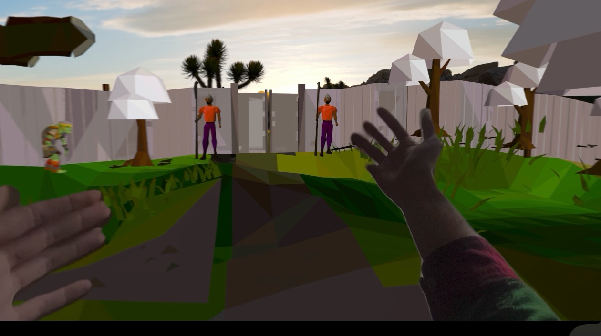

# RuneScale

Room-scale Old School RuneScape viewer for Apple Vision Pro. Mirrors the live scene from your
own RuneLite client on your Mac. Optional headset input (tap to click, off by default). No game assets are shipped; geometry is streamed
from the running client over the local network.




- `runelite-plugin/`: RuneLite plugin "RuneScale Stream" (Java 11, Gradle).
- `RuneScaleVision/`: visionOS app (XcodeGen, SwiftUI, RealityKit).
- `notes/RESEARCH.md`: rules, prior art, risk. `notes/PROTOCOL.md`: wire format. `notes/ROADMAP.md`: plan.

## Plugin

```
cd runelite-plugin
./gradlew build          # compiles and runs ProtocolTest
./gradlew run            # launches RuneLite in developer mode with the plugin loaded
```

Log in with your account. Open the RuneScale Stream side panel (blue goggles icon). It shows the
Mac IP, port (default 43595) and a 6-digit pairing token. Config: radius (default 24 tiles),
static rescan interval, Bonjour toggle.

Developer mode sideloading is for development. The supported path for regular use is Plugin Hub
submission (see notes/RESEARCH.md).

## Headset app

```
cd RuneScaleVision
xcodegen
open RuneScaleVision.xcodeproj   # scheme RuneScale, set your team, run on device
```

1. Mac and Vision Pro on the same Wi-Fi. Allow local network access when prompted.
2. Enter the pairing token, then tap the Mac under Nearby RuneLite, or type the IP under Manual.
3. Enter room-scale: the world is anchored to the floor with your character at your feet.
   Life size 1.0 = one tile per meter. Open tabletop for a volume view.

Tests: `xcodebuild -scheme RuneScale -destination 'platform=visionOS Simulator,name=Apple Vision Pro' test`.

## Replay harness (simulator)

Plugin option Record stream writes `~/.runelite/runescale/capture-<time>.rsrec` (UI_FRAME skipped).
Launch the headset app with `-replay <path>`, `-replay mock` (synthetic scene plus legacy white-texture
rows for comparison) or `-replay mock-clean`; `-replayView immersive|tabletop|none` picks the opened view.

```
xcrun simctl launch --console-pty "Apple Vision Pro" org.oldschool.runescape.runescale -replay ~/.runelite/runescale/capture-X.rsrec
```

The console prints a ColorAudit line (near-white meshes and tiles); the Replay section shows the same counts.
